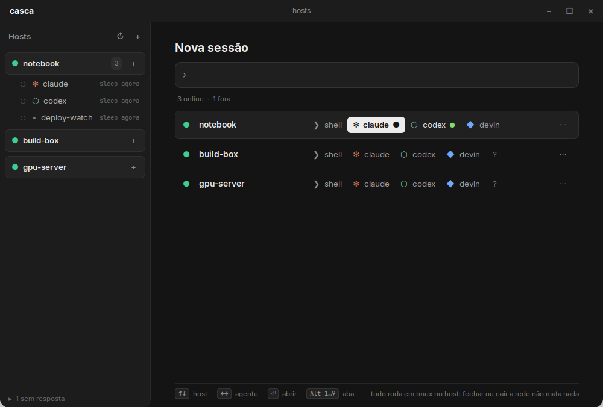

# casca

Abre shells e agentes de código (claude, codex, devin…) em **outros hosts**, por ssh + tmux, a partir
de uma máquina fraca. Um binário Go estático (linux/386, ~6 MB) e uma janela GTK3 opcional.

*Open coding agents and shells on your other machines over ssh + tmux, from a weak one. A single static
Go binary (linux/386) plus an optional GTK3 window. Docs are in Portuguese.*

**Site:** https://casca.jazzautomations.com.br



Nasceu num Dell D610 (Pentium M, 2 GB, WiFi que cai): o casca só transporta terminal; o agente roda
no host de destino, dentro de tmux. Fechar a aba, o navegador ou perder a rede **não mata o agente**.

## Três jeitos de usar

**Janela nativa (GTK3 + VTE, sem navegador):**

    casca-gui                       # ou o ícone "casca" no menu / área de trabalho
    casca-gui --open servidor:claude

À esquerda, um cartão por host com as sessões tmux vivas lá (abertas aqui ou não), cada uma com
estado: girando = saindo texto, ponto verde = parou e você ainda não viu. À direita, abas de terminal.
"Nova sessão" escolhe host e agente pelo teclado (↑↓ ←→ Enter) ou digitando `host agente` / `user@host`.
Ctrl+Shift+K nova sessão · Alt+1…9 e Ctrl+PgUp/PgDn abas · Ctrl+Shift+W fecha a aba (o tmux continua) ·
Ctrl +/- fonte · Ctrl+Shift+C/V copiar/colar · F11 tela cheia.
Cada aba roda `casca connect`, então a reconexão é a mesma dos outros modos.
Precisa de `python3-gi`, `gir1.2-gtk-3.0` e `gir1.2-vte-2.91`. No D610: abre em ~4 s e usa ~110 MB.

**No terminal (o mais leve, recomendado sentado no D610):**

    casca tui

Menu de hosts → agente ou sessão viva → conecta. `Ctrl-b d` (detach do tmux) volta pro menu.
Se a rede cair, ele reconecta sozinho e reanexa na mesma sessão.

**No navegador (D610, celular, qualquer máquina da tailnet):**

    casca url        # mostra os endereços já com o token

Abas, lista de hosts com bolinha de online, sessões vivas por host, teclas extras pro celular
(esc, tab, ⇧tab, ctrl/alt grudentos, setas, ^C…), snippets, busca (Alt+K), lado a lado,
colar/enviar imagem pro host (cai em `/tmp/casca-*` e o caminho é digitado no terminal).
As abas vivem no servidor: abriu no celular, aparece no notebook.

## Como funciona

    navegador ──ws──> casca (laptop) ──ssh -tt──> host: tmux new/attach c-<agente>

- Sessão nova: cria o tmux, abre o shell normal do usuário e **digita** o comando do agente.
  Assim o agente pega o mesmo PATH que você teria na mão, e sair do agente deixa um shell.
- Queda de rede: ssh sai com 255 → o casca reabre o ssh com espera 1, 2, 4, 8, 15 s, pra sempre.
  A reconexão só **reanexa**; nunca recria (não relança agente sozinho).
- Erro de autenticação não é repetido (não martela o host).
- Reabrir uma aba não reenvia bytes velhos: o casca força o tmux a redesenhar a tela.
- Saída em frames binários com ACK do navegador: produtor rápido não afoga navegador lento.

## Config

`~/.config/casca/config.json` (criada no primeiro uso, recarrega sozinha ao salvar):

```json
{
  "token": "…",
  "listen": "127.0.0.1:7681,tailscale:7681",
  "hosts":  [{"name": "servidor", "target": "dev@100.64.0.5", "group": "tailnet", "dir": "~/proj"}],
  "agents": [{"name": "claude", "cmd": "claude", "tmux": true}],
  "snippets": [{"label": "git status", "cmd": "git status\n"}]
}
```

`tailscale:PORTA` escuta só no IP da tailnet (e espera o tailscale subir). Nunca escuta em 0.0.0.0.
Hosts também podem ser adicionados pela interface (`+ host`) ou no TUI (`a`).

## Instalar

    go build -o casca . && ./casca init && ./casca tui

Num host remoto com runit (ex.: antiX), a partir da máquina de build:

    ./deploy/install.sh root@HOST USUARIO

Compila pra 386, copia, cria o serviço runit (`/etc/sv/casca`), reinicia e mostra a URL.
Versão anterior fica em `~/.local/bin/casca.prev`. Log: `/var/log/casca/current`.

## Testes

    go test -race ./...

Cobrem: reconexão após queda (com ssh falso), não-repetição em erro de auth, criação única do
tmux, ponta a ponta HTTP+websocket com tmux real, origem cruzada recusada, upload.

## Notas

- O estado de cada sessão na janela nativa vem da atividade do terminal (texto saindo = trabalhando) e do sino.
- Hosts que pedem aprovação interativa (ex.: Tailscale SSH em modo "check") mostram o link na aba e o
  casca espera até 10 minutos.
- A rolagem do histórico é a do tmux (mouse/toque ligado por sessão; `"tmux_mouse": false` desliga).
- Em HTTP puro o navegador esconde a área de transferência; na interface web o botão "colar" pede o texto.

Estudos que embasaram o desenho: `docs/research/` (Termius, Orca, prior art).

## Licença

MIT. O xterm.js em `web/vendor/` é MIT, dos seus autores.
